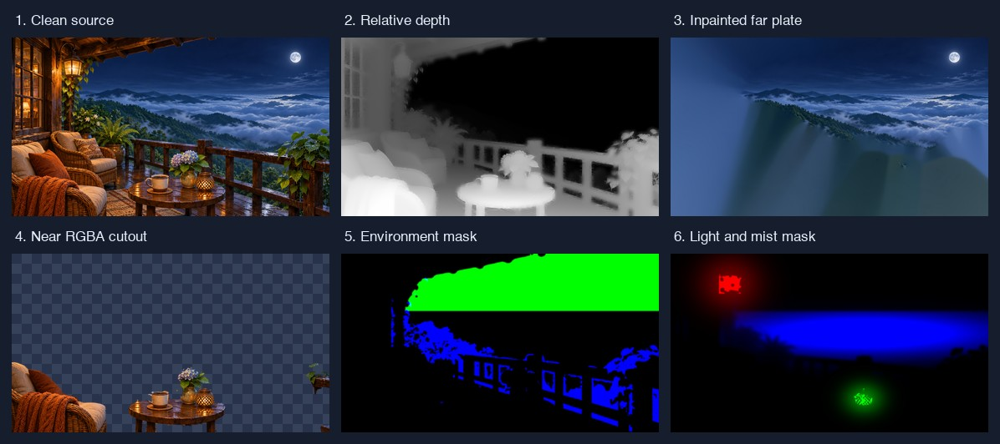

# Lo-Fi Serene

Six illustrated scenes with 2.5D camera motion, scene-specific shader animation, and a lo-fi radio. [Open the player on GitHub Pages](https://vinayanand3.github.io/lofi-serene/).

Each scene starts as one still image. A local Python pipeline estimates relative depth, separates the image into five aligned cards, fills the hidden areas behind them, and exports masks for individual effects. Three.js turns those files into a moving scene in the browser.



## Run the player

Use Node.js 22 and npm. From the repository root:

```bash
npm ci
npm run dev
```

Open the address printed by Vite. The player starts on **India · Terrace**, and the scene selector offers the other dioramas. The exported textures are checked in, so this step needs only the JavaScript dependencies and a WebGL 2 browser. Use **Ambience** for the locally synthesized environmental audio. YouTube playback depends on the selected video's embedding settings and the browser's autoplay policy.

If your browser blocks the built-in radio from starting automatically, tap **Tap for sound** to start it.

The scene fills the window. On very wide or tall screens a blurred copy of the scene fills the space around the art instead of black bars. After a few still seconds the title, scene row, and buttons fade away so only the scene remains; move the pointer, tap, or press a key to bring them back. Press **F** for full screen, **S** for the next scene, and **Space** to pause the animation. The player remembers the last scene you opened.

Scene thumbnails in the switcher come from `public/assets/thumbs/`. When you add a scene, save a 320 px wide JPEG of its source image there as `<scene-id>.jpg`.

```bash
npm run build
npm run preview
```

## Recreate a scene

### 1. Generate and refine one source image

We used the built-in image generator to make the source illustrations, then revised composition, lighting, and style with the previous image as the reference. The scene notes below retain the prompts for the cottage, Himalayan dawn, Kerala monsoon, and rooftop sleepover. Reuse the included PNG or JPEG for the same starting plate. Re-entering the prompt can produce a different composition.

- Start with a wide RGB image. The newer scenes use 1672 × 941. Keep that canvas and framing fixed after measuring anchors.
- Ask for clearly separated near objects, architecture, landscape, and sky. Leave some room at the borders for the camera to move.
- Leave rain streaks, coffee steam, and any other shader-driven motion out of the still image. Wet surfaces, reflected light, and painted clouds can stay in the source.
- Check that anchor objects have readable silhouettes. For Kerala, we simplified the mug, kettle, and porch to match the character art. For the terrace, we relit the scene in indigo and pulled the camera back before measuring positions.

Save the final image to [`assets/source/`](assets/source/). Keep earlier drafts outside the active scene configuration.

### 2. Run Depth Anything V2 Large on Apple Silicon

Install [uv](https://docs.astral.sh/uv/getting-started/installation/). On an Apple Silicon Mac, use an arm64 terminal and let uv select Python 3.12. The committed lockfile pins the Python packages. [PyTorch MPS documentation](https://docs.pytorch.org/docs/stable/notes/mps.html).

```bash
cd pipeline
uv sync --locked --python 3.12
uv run --locked --python 3.12 python -c 'import platform, torch; print(platform.machine(), torch.__version__); print("MPS available:", torch.backends.mps.is_available())'
uv run --locked --python 3.12 python build_diorama.py moonlit-cottage
```

Expect `arm64` and `MPS available: True` on a supported Mac. The pipeline logs `device=mps` when it uses Metal. If a sandbox or remote session cannot see the GPU, rerun the check in a local Terminal. The pipeline selects MPS first, then CUDA, then CPU.

On the first run, Transformers fetches the processor and checkpoint from Hugging Face. Inference runs on your machine. The model is loaded once per invocation, even when you pass multiple scene IDs. Omit the IDs to rebuild all configured scenes. The Large checkpoint is licensed CC BY-NC 4.0. [Model card and license](https://huggingface.co/depth-anything/Depth-Anything-V2-Large-hf) · [Depth Anything V2 project](https://github.com/DepthAnything/Depth-Anything-V2).

Inside [`pipeline/build_diorama.py`](pipeline/build_diorama.py), `estimate_depth` moves the input tensors and model onto the selected device, runs inference without gradients, and resizes the prediction to the source dimensions. It normalizes using the 1st and 99.5th percentiles, then uses an OpenCV guided filter with the source luminance to refine depth boundaries. White represents nearer pixels and black represents farther pixels in the exported 8-bit map. These are relative values within each image.

### 3. Build five aligned parallax cards

The pipeline uses the refined floating-point depth for slicing and saves the grayscale map separately for the shader.

1. `slice_layers` starts with four depth cutoffs at the 28th, 54th, 74th, and 88th percentiles. Set `customThresholds` to four ascending values between 0 and 1 when those percentiles split objects poorly.
2. Treat important objects as one silhouette. The Darjeeling and Kerala masks group their tea sets and furniture. The rooftop helper includes the cousins, bedding, and pointing arm on the foreground card. These are scene-specific masks built from depth thresholds, drawing coordinates, or both.
3. Fill the areas behind any closer card with OpenCV Telea inpainting. The pipeline downsamples the image for the fill, upsamples the result, and feathers it at the boundary. This gives small camera shifts some background to reveal.
4. Extend the middle cards slightly underneath closer ones, feather alpha edges, and bleed neighboring RGB colors up to 12 pixels past the alpha boundary to reduce sampling fringes.
5. Export five full-canvas RGBA PNGs in far-to-near order. The far card is opaque. Each other card has a transparent cutout. All five PNGs, the depth map, and both shader masks share the source dimensions and origin.

Inspect the stack at rest and at the extremes of the intended camera movement. Halos, doubled outlines, or seams usually mean the same object needs to be on one plane, the cutout needs more overlap, or the per-scene camera movement should be reduced. Single-image inpainting only reconstructs small hidden patches plausibly, so the camera motion stays shallow.

### 4. Mark the parts that should move or glow

The Python pipeline combines depth, color, and per-scene regions to produce two packed RGB textures. Each channel stores one grayscale effect weight.

| Export | Red | Green | Blue |
| --- | --- | --- | --- |
| `mask_env.png` | Water and reflections | Sky, stars, and moon | Foliage |
| `mask_glow.png` | Main lamp | Secondary lamp or diya | Valley mist or the painted cloud banks in Darjeeling |

Coordinates in the scene configuration are normalized from the top-left of the still image. For a pixel at `(x, y)` in a source of size `W × H`, use `[x / W, y / H]`. Regions such as `water`, `lantern1`, and `mistBand` use `[left, right, top, bottom]`. A water rectangle of four zeros disables the default water mask. The renderer flips the vertical coordinate for shader UVs where needed.

Use small regions for specific motion. Place the steam anchor at the liquid surface or spout. Trace the cloud banks away from prominent ridgelines. Keep the terrace chuckle around the lower lip and feather it to zero before the face outline. The terrace uses the blue environment mask to confine the breeze to the original potted plants.

### 5. Add a scene and tune it in the player

1. In [`SCENES`](pipeline/build_diorama.py), copy the closest scene entry. Change `id` to a unique slug, `source` to your file name, and the display fields to your scene labels. Start from `moonlit-cottage` for a wet scene with steam or `summer-terrace` for a dry night. Pick an existing `soundProfile` from [`src/audio/soundscape.js`](src/audio/soundscape.js). Clear effects and regions that do not apply to the new image, and remeasure the anchors and masks.
2. For example, with a source named `evening-veranda.png` and the ID `evening-veranda`, put the file under `assets/source/` and run the following from the repository root.

   ```bash
   cd pipeline
   uv run --locked --python 3.12 python build_diorama.py evening-veranda
   cd ..
   npm run dev
   ```

3. The exporter writes `public/assets/scenes/evening-veranda/manifest.json`, the five layer PNGs, `depth_map.png`, `mask_env.png`, and `mask_glow.png`. It also refreshes `public/assets/scenes.json`. Reload the browser and select the new badge. Commit the source image, scene configuration, catalog, and generated scene folder together.
4. In [`src/main.js`](src/main.js), the manifest drives card loading and layout. The camera sees the same image framing on all five planes at rest because each plane is scaled for its distance. Moving the camera then gives near and far planes different apparent motion. The layer vertex shader adds a small depth-based displacement within each card. Tune `parallaxStrength` and `depthRelief` in the scene effects when architecture or people appear to separate. For plane spacing, use the layer `z` values emitted by `slice_layers`.
5. In [`src/shaders/layerShaders.js`](src/shaders/layerShaders.js), the shader samples the masks to limit water distortion, cloud drift, foliage, and light to the intended pixels. [`src/shaders/fxShaders.js`](src/shaders/fxShaders.js) provides the rain, fog, and steam effects. Color textures are loaded as sRGB. The depth and mask PNGs are loaded as data textures.
6. Compare a centered frame and an offset frame, toggle Auto Drift, and check the scene at wide and narrow viewport sizes. Watch the animation with reduced motion enabled as well. For more precise edits, open the exported layer PNGs over a checkerboard and stack them from 0 to 4 to compare against the source.

## Publish the player

The [GitHub Actions workflow](.github/workflows/pages.yml) installs the locked npm dependencies, runs Vite, and uploads `dist/`. Vite uses relative asset paths so the scene catalog and images also work under a repository subpath. GitHub Actions uses the committed scene exports and does not run Python, download model weights, or need an Apple GPU. [Vite relative base paths](https://vite.dev/guide/build.html#relative-base).

For a fork, open **Settings → Pages**, select **GitHub Actions** as the source, then run **Deploy GitHub Pages** from the Actions tab. Pushes to `main` run it again. GitHub Pages can publish the built site publicly even when its source repository is private, depending on the account plan. [GitHub Pages publishing sources](https://docs.github.com/en/pages/getting-started-with-github-pages/configuring-a-publishing-source-for-your-github-pages-site).

## Scene notes and image prompts

### Moonlit Mountain Cottage

Choose **Mountain Cottage · Drizzle** in the scene switcher. The original
1672 × 941 RGB plate is in `assets/source/moonlit_cottage.png`. The five aligned
RGBA layers, 8-bit grayscale relative depth map, two packed shader masks, and
manifest are in `public/assets/scenes/moonlit-cottage/`.

Composite the PNG layers from 0 (farthest) to 4 (nearest), using the same
full-frame UVs for each texture. The depth map uses white for nearer pixels
and black for farther pixels. Sample depth and mask textures as linear data.
The manifest records the top-left-origin normalized coffee, lantern, and moon
anchors. Drizzle, drifting mist, and coffee steam are generated by the shaders.
The still plate contains the cloud sea and wet surfaces.

In `mask_env.png`, green targets sky and blue targets foliage. In
`mask_glow.png`, red targets the hanging lantern, green targets the table
lantern, and blue targets valley mist.

To rebuild only this scene, run the following from the project root with the
pipeline environment active. The pipeline selects Apple Silicon MPS when
PyTorch can access Metal.

```bash
cd pipeline
uv run --python 3.12 python build_diorama.py moonlit-cottage
```

The source art was created with the built-in image generator using this prompt.

> Use case: illustration-story. Create one wide landscape 16:9 hero background for a serene nighttime lo-fi radio, softly painterly, beautifully detailed original hand-painted cinematic environment art. View from within a sheltered rustic cottage balcony high on a lush emerald-green mountain, looking out over a sea of silver-blue clouds and layered mountain tops at night. Soft warm amber cottage lamplight from the upper left on wet dark timber and warmly inviting upholstered wicker lounge chairs, with a ceramic cup of hot coffee on a small table in the near foreground. A few lush plants along the balcony. Leave a large uninterrupted opening in the upper center and right for the beautiful cloud vista. Quiet indigo sky. Cozy refuge during gentle drizzle, with damp reflective timber and rain-softened atmosphere. Create the clean RGB plate for compositing: omit airborne rain streaks and visible coffee steam so they can be animated separately. Strong depth separation between near furniture, wood balcony edge, forested slopes, cloud sea, and dark sky, with clearly legible silhouettes and ample tonal detail even in the shadows. Keep the coffee cup clear and away from the image border. No people, lettering, logos, borders, panels, or watermarks. One cohesive scene.

### Himalayas · Dawn Clouds

The cel-shaded source is in `assets/source/darjeeling_dawn_cel.png`. The
aligned Depth Anything V2 map, five PNG layers, and shader masks are in
`public/assets/scenes/darjeeling/`. The blue channel of `mask_glow.png`
marks the three cloud banks that drift in the background shader. The cup
steam is anchored at the tea surface.

```bash
cd pipeline
uv run --python 3.12 python build_diorama.py darjeeling
```

The cel-shaded source was created with the built-in image generator using this prompt.

> Use case: illustration-story. Draw an original wide 16:9 hand-drawn 2D cel-shaded background for a serene lo-fi radio scene, Himalayan dawn from a Darjeeling hill bungalow. The valley and the magnificent snow-covered Himalayan peaks are the stars of the composition, with distinct bands of dawn sky, distant small warm peach snow peaks, dark lavender blue foothills, broad billowing layers of pearl and lavender cloud in the valley, and lush emerald curved Darjeeling tea terraces with just a few pink flower bushes in the middle ground. Soft apricot sunrise at the left horizon and pale blue upper sky. View from a sheltered timber bungalow veranda, eye-level and wide cinematic framing. Keep the architectural framing sparse: a narrow timber wall/post only at the extreme left edge, a simple short eave entering from the upper-left less than halfway across the frame, a low railing primarily along the bottom, open unobstructed right and center with no central post and no right-side post. A single small amber brass lantern hangs beneath the far-left eave, clearly silhouetted. Near foreground in the bottom left and center: a small simple oval wood tea table entering from the bottom edge, with a clearly visible ceramic cup of tea (dark freshly poured tea visibly inside, no steam in this clean plate), a small teapot, and one small glowing table lantern. Give the tea set room to breathe, keep the cup fully in frame. A short string of colorful prayer flags across one nearby hillside well behind the railing, keep the valley largely clear. Art direction: sophisticated anime-inspired background art with crisp restrained ink outlines, decisively cel-shaded blocks of color and 2 to 3 clean color values per surface, softly luminous painted sky and clouds, subtle paper texture, clean leaf and cloud silhouettes. Colorful and elegant, warm dawn shadows retain detail, soft peach glint on snow, no crushed blacks, no photorealism, no 3D look, no heavy bloom. Strong silhouette separation between covered veranda, tea table, tea hills, cloud sea, ridgelines, and sky for independent parallax layers. Aim for a tranquil sense of altitude and generous negative space. No lettering, logo, watermarks, people, borders, rain, or baked-in steam.

### India · Rainy Night

The new cel-shaded veranda is in `assets/source/kerala_monsoon_cel.png`.
The five aligned PNGs, Depth Anything V2 Large map, and shader masks are in
`public/assets/scenes/kerala/`. The red channel of `mask_env.png` restricts
reflection movement to the lagoon. The two steam emitters follow the mug and
kettle anchors in the manifest.

```bash
cd pipeline
uv run --python 3.12 python build_diorama.py kerala
```

The artwork was created and refined with the built-in image generator.

> Generate one original wide 16:9 cinematic cel-shaded 2D animated-film background for the India Rainy Night lo-fi scene. Theme: a quiet family moment at a modest, real Kerala backwater home at night during monsoon. Contemporary naturalistic observational animation, restrained fine dark outlines, sophisticated clean two or three-tone cel shading on surfaces, with a softly painted cinematic background, beautiful diffuse light, gentle subtle grain. No decorative folk-art or mural patterns, no graphic floral ornament, no ornate borders. Composition is a wide fixed low eye-level view from inside a simple unadorned sheltered veranda. An eave and plain wooden post frame the upper and far left, a single muted amber lamp to the left, and lots of open water and quiet night air in the center and right. Foreground left near lower third: a simple low wood tea table, an everyday stainless steel kettle with a very clearly visible spout pointing left or up from the kettle, and a small cream ceramic coffee mug, its lip, dark coffee surface and handle unmistakably readable, both fully visible. Mother and small boy at the right, sitting together under the cover on the outer edge of their porch, relaxed, seen in three-quarter rear profile. The mother smiles gently as she looks toward a tiny distant wooden Kerala houseboat with a single warm lit window; the boy watches the rain. Everyday cotton clothes, believable uncomplicated silhouettes, restrained natural expressions. Keep the child and mother entirely out of the boat silhouette, with a visual gap. Background: coconut palms along a distant shore silhouetted against a softly overcast indigo-gray night, a large still lagoon, sparse broken horizontal reflections, the boat's modest amber gleam. Overall grade: quiet cool-blue and slate-green exterior, softly glowing warm ivory inside, naturally colored skin and muted clothes; preserve readable nighttime midtones. Damp timber, humidity and rain-softened air imply the weather. Deliver a shader-ready clean plate: absolutely no airborne rain lines, no drawn ring ripples or patterned surface marks, and no visible steam from the mug or kettle. Subtle irregular horizontal reflection marks only. Separate easily read silhouettes for the sky and shore, water, porch and figures, and tea service. No text, signage or logos.

> Edit the provided 16:9 Kerala monsoon scene. Preserve composition absolutely, same camera, exact layout and sizes, the mother and child unchanged, the houseboat unchanged, the same dark blue lagoon and warm wall lamp. Make the WHOLE scene look drawn in the same 2D cel-shaded animation style as the mother and boy. Prioritize the foreground objects: redraw the stainless steel kettle and cream coffee mug in place as clearly hand-drawn 2D animation props, with fine dark ink outlines that match the figures, simple flat fills, two or three sharply defined tone bands, and clean simple silhouettes. Kettle should read as muted slate bronze metal with a small pale graphic highlight band and no realistic metallic gradients or sharp reflected environment. Keep the curved upward-facing spout on the left. Keep the cream mug's dark coffee surface and round handle clearly visible, no steam. Simplify the tabletop, wet deck, beams and masonry to understated hand-drawn tonal shapes with the same line weight, remove photo-real texture and reflections, and keep the lagoon's reflections soft, irregular and mostly horizontal. Preserve the navy/slate exterior and restrained amber/cream accents and existing light and shadow directions. Keep the human poses, identities, anatomy, clothes, heads, proportions and expressions exactly the same. No folk ornamentation, no realism, no 3D sheen, no drawn rain lines, no circular water rings, no visible vapor, no text. One clean plate for later shader animation.

### India · Summer Terrace

The wide moonlit artwork is in `assets/source/indian_summer_terrace.png`.
Its five aligned depth layers, Depth Anything V2 Large map, and shader
masks are in `public/assets/scenes/summer-terrace/`. The green channel of
`mask_env.png` confines the star shimmer and moonlight to the sky. Its blue
channel confines the breeze to the potted plants. Two feathered regions on
the foreground card animate the sleeping cousins' clothing in separate
breathing cycles. The awake cousins chuckle, point, and swing their feet.
The pointing gesture cues the Big Dipper, Boötes, and Corona Borealis in turn.
Tap the flashlight beside the sleeping girl's pillow to switch its light on or off.
The [transparent flashlight sprite](public/assets/scenes/summer-terrace/torch.png)
uses the same top-left image coordinates as the other scene anchors.
Tap the wall lamp to dim it or tap the sky to reveal the next constellation.
**Controls** also provides buttons for both actions.
The ambience uses crickets and a light breeze, with
Starlight Drift on the radio.

```bash
cd pipeline
uv run --python 3.12 python build_diorama.py summer-terrace
```

The scene was created, relit, and reframed with the built-in image generator.

> Create an original 16:9 wide cinematic scene in a cohesive hand-drawn 2D cel-shaded animation style for a lo-fi radio background, a joyful summer night on a family rooftop terrace in India. It is a warm dry summer night, with four or five Indian children and cousins ages seven to fourteen having a rooftop sleepover on two large cotton quilts and ordinary thin mattresses on the paved floor of a roomy flat-roof Indian home. All fully clothed in simple breathable cotton pajamas and T-shirts. Children have distinct silhouettes and hair, accurately drawn hands and faces. Some have drifted off to sleep, one older cousin lying back points toward a constellation, and another turns toward the group with a delighted sleepy grin, an easy affectionate bond among cousins on summer holiday. Three-quarter wide view from terrace level, showing the group as a cozy foreground vignette across the bottom third, with generous breathing room around them and several separate clear adult-free child silhouettes. Low solid stucco parapet behind them, a few terracotta planters and a single soft amber utility light far left, distant low-rise Indian neighborhood rooftop silhouettes and scattered warm windows below the horizon. The upper half is an expansive clear deep cobalt to violet night sky with delicate sparse small stars and a fine luminous crescent moon, elegant rather than busy. A little pale blue haze along the horizon, entirely dry weather. Warm amber accents on quilts, real Indian skin tones, terracotta and soft sage or dusty orange fabric, readable indigo shadows. Every element, including props and background, illustrated in the same carefully drawn animation style with simple flat tonal shapes, restrained fine dark outlines, two to three believable tone bands, and no realistic 3D render textures. Soft, unhurried, playful, full of love and joy. Design for parallax compositing, with well-defined silhouettes separating the sky, distant rooftops, parapet and planters, floor, and cousins and bedding. No typography, no decorative border, no rain, no illuminated string lights, no fantasy objects or fireworks.

> Edit this exact Indian rooftop sleepover image as a NIGHT RELIGHT only. Preserve the camera, layout, poses, precise facial expressions, clothing, folds, quilt patterns, planters and all silhouettes in the provided cel-shaded image. Make it unmistakably deep late night outdoors: cool moonlit indigo-blue and navy shadows over the majority of the terrace, with subtle desaturated blue moonlight from the upper right and extremely soft silver outlines on the cousins and their quilts. Shift the broad warm orange illumination into cool subdued midnight hues without losing readable midtones. The terracotta and orange quilt should look dusky plum/rust in cool moonlight, the sage quilt muted blue-green. Preserve real skin tones rendered at the much lower light level with cool shadows and only a whisper of warm reflected fill near the far left. Dim the wall utility light drastically to a small softly luminous point and confine its weak amber spill to a tiny patch right beside the lamp, no amber wash on the terrace or people. Dim neighborhood window lights and leave only a handful. Make the starry sky deep midnight blue, quiet and clear, crescent moon and star positions unchanged. Preserve same compositions, joy, distinctive character designs, expressions and 2D cel-shaded style, full landscape 16:9. Do not flatten everything into silhouette, avoid pure black clipping, no new characters, props, text or flares.

> Create a genuinely ZOOMED-OUT, wide establishing-shot version of this exact cool moonlit Indian rooftop sleepover illustration. Move the virtual camera back by about 50 percent and slightly elevate it so we can see the entire usable rectangular rooftop terrace, all five cousins, the full edges of both quilts and all mattress corners, open floor on all sides of the bedding, a continuous low protective plaster parapet across the back and along BOTH sides, a little plain rooftop stairwell doorway at the far left, and a few potted plants tucked against the perimeter. Show the right and left terrace corners and plenty of near foreground tiled floor. The cousins together and all their bedding should occupy only about 55 to 65 percent of image width, with a relaxed grouping, positioned around the midground lower center, and there must be visible floor space between beds and every edge of the image. Keep precisely the same five Indian children, clothes, ages, sleepers, pointing gesture and joyful expressions from the reference, casually under a spacious night sky. A distant quiet low-rise Indian neighborhood sits beyond the terrace. The sky still occupies roughly the top 45 percent, with the small crescent moon and delicately drawn stars; the older cousin points into this sky. All surfaces, foreground, and figures in the same clean hand-drawn 2D cel-shaded animation style as the reference. Retain the reference deep midnight-blue and cool silver-light color grading throughout, recognizable fabric colors only under moonlight. A tiny soft amber lamp at the far-left doorway, very localized, no warm wash on bedding or children. Preserve the late-night darkness and a little cool edge light on silhouettes. Use a natural wide-angle architectural perspective with straight verticals and intentional composition. Original artwork, landscape 16:9, no text, frame, border, adult figures, or excessive bright lighting.
